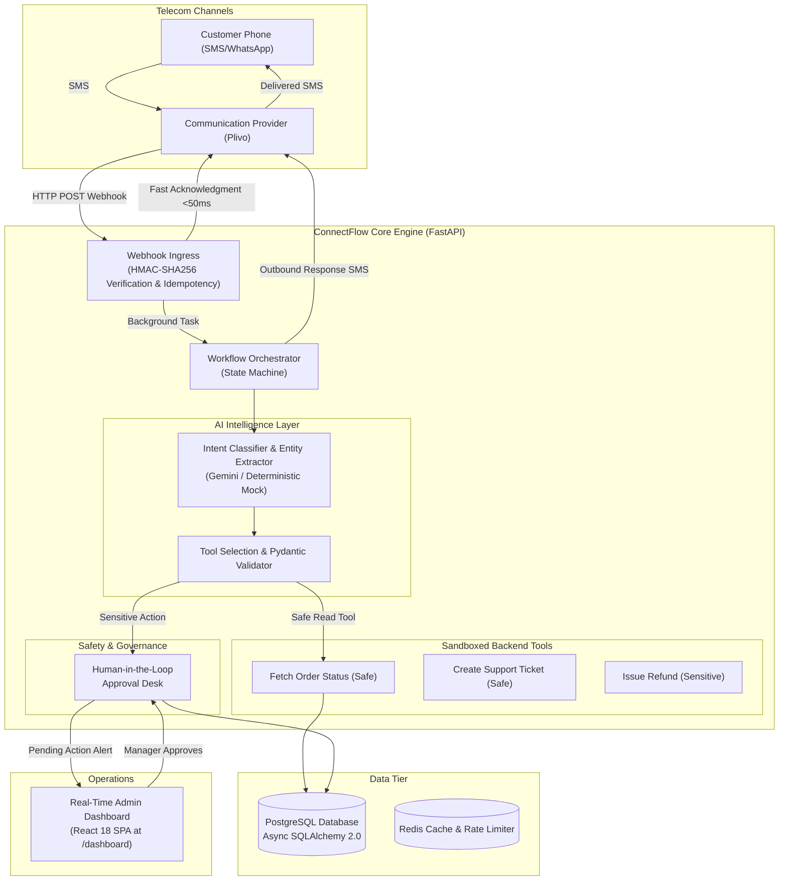

# ConnectFlow — AI-Powered Customer Communication & Integration Platform

ConnectFlow is an enterprise-grade customer communication and workflow automation platform built with Python, FastAPI, Async SQLAlchemy 2.0, and modern AI tool calling.

It listens to incoming customer messaging events (SMS, WhatsApp, Webhooks), classifies customer intent, extracts key entities (such as order IDs), executes sandboxed backend tools, enforces **Human-in-the-Loop (HITL)** approval for sensitive financial actions, and returns context-aware responses to customers.

---

## Architecture Overview



---

## Key Features

- **Asynchronous Architecture**: High-throughput non-blocking I/O with FastAPI, `asyncpg`, and `httpx`.
- **Cryptographic Security**: Canonical HMAC-SHA256 webhook signature verification with constant-time comparison (`hmac.compare_digest`) to prevent spoofing and timing attacks.
- **Provider-Agnostic Telecom Layer**: Clean Adapter Pattern with support for **Plivo REST API** and a zero-cost **Mock Client** for development and automated testing.
- **Enforced AI Guardrails**: Strict Pydantic JSON schemas. **Zero arbitrary code execution and zero direct database access by LLMs.**
- **Human-in-the-Loop (HITL) Safeguards**: Sensitive financial mutations (e.g., refunds) are automatically paused in `pending_approval` state until reviewed by a supervisor.
- **Production Resilience**: Exponential backoff with full jitter retries, sliding-window rate limiting (`HTTP 429`), and structured JSON logging.
- **Built-in Operations Dashboard**: Real-time web console at `/dashboard` with an interactive customer SMS simulator and approval desk.

---

## Quick Start (Local Development)

### 1. Prerequisites
- Python 3.11+ (Python 3.13 supported)
- Git

### 2. Clone and Setup Environment
```bash
git clone https://github.com/Akashk2102/ConnectFlow.git
cd connectflow

# Create and activate virtual environment
python -m venv venv
# On Windows:
.\venv\Scripts\activate
# On Linux/macOS:
source venv/bin/activate

# Install dependencies
pip install -r requirements.txt
```

### 3. Initialize & Seed Database
```bash
python scripts/seed_db.py
```
This automatically initializes the schema and creates a demo business account:
- **API Key**: `cf_live_demo_key_12345`
- **Business Name**: Acme Retail Corp

### 4. Run Development Server
```bash
uvicorn app.main:app --reload --port 8000
```
- **Operations Dashboard**: [http://localhost:8000/dashboard](http://localhost:8000/dashboard)
- **Interactive OpenAPI Documentation**: [http://localhost:8000/docs](http://localhost:8000/docs)
- **Health Check**: [http://localhost:8000/api/v1/health](http://localhost:8000/api/v1/health)

---

## Running with Docker Compose

To spin up ConnectFlow with production PostgreSQL and Redis in containers:

```bash
docker compose up --build
```
The API is available at `http://localhost:8000`, PostgreSQL at port `5432`, and Redis at port `6379`.

---

## Running the Automated Test Suite

We maintain 100% automated test coverage across all features:

```bash
pytest
```
**36 test cases passing in under 10 seconds**:
```text
tests/test_health.py               [Pass]
tests/test_models.py               [Pass]
tests/test_customers_api.py        [Pass]
tests/test_messages_api.py         [Pass]
tests/test_webhooks.py             [Pass]
tests/test_messaging_service.py    [Pass]
tests/test_ai_classifier.py        [Pass]
tests/test_tools_and_approvals.py  [Pass]
tests/test_workflow_orchestrator.py [Pass]
tests/test_resilience.py           [Pass]
tests/test_dashboard.py            [Pass]
```

---

## Environment Variables Reference

| Variable | Default | Purpose |
| :--- | :--- | :--- |
| `APP_NAME` | `ConnectFlow` | Application display name |
| `APP_ENV` | `development` | Environment: `development`, `staging`, `production`, `testing` |
| `DATABASE_URL` | `sqlite+aiosqlite:///./connectflow.db` | SQLAlchemy async connection URI |
| `POSTGRES_SERVER` | `localhost` | PostgreSQL host when using Postgres |
| `REDIS_URL` | `redis://localhost:6379/0` | Redis caching & rate limiting endpoint |
| `PLIVO_AUTH_ID` | `mock_plivo_auth_id` | Plivo Account Auth ID (or mock for simulation) |
| `PLIVO_AUTH_TOKEN` | `mock_plivo_auth_token`| Plivo Secret Auth Token for signatures |
| `PLIVO_PHONE_NUMBER`| `+18005550199` | Default sender phone number in E.164 format |
| `LLM_PROVIDER` | `gemini` | LLM service provider |
| `LLM_API_KEY` | `mock_llm_api_key` | Google Gemini API key (or mock for simulation) |

---

## Documentation Index

- [Architecture & Threat Model](docs/ARCHITECTURE.md)
- [REST API Reference](docs/API_DOCUMENTATION.md)
- [Telecom & LLM Integration Guide](docs/INTEGRATION_GUIDE.md)
- [Production Troubleshooting Guide](docs/TROUBLESHOOTING.md)
